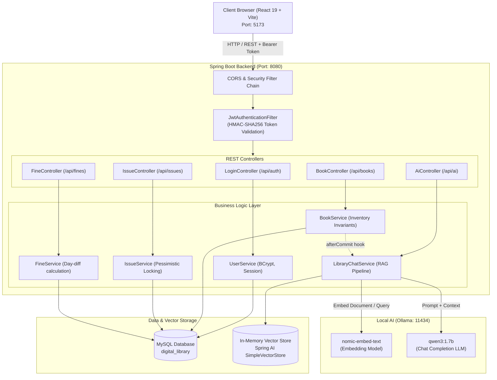
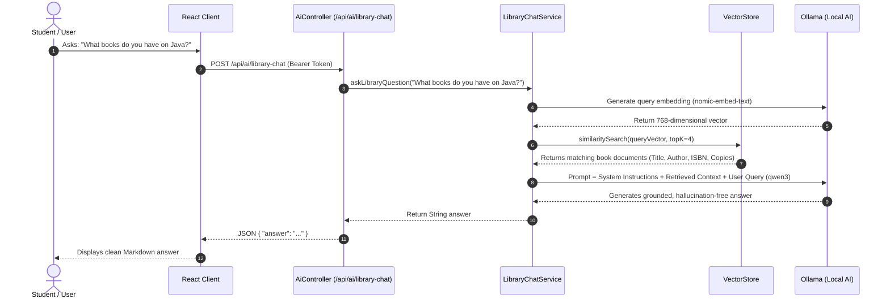
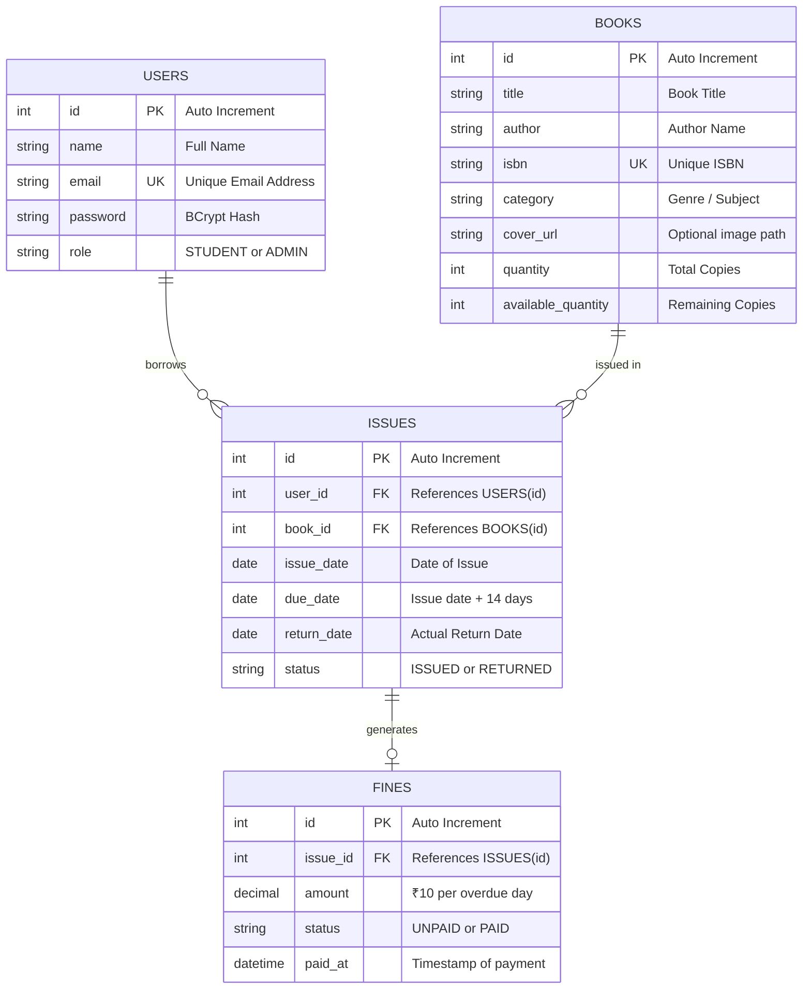

# 🏛️ Digital Library Management System — System Architecture & Technical Documentation

---

## 1. 📌 Executive Overview
The **Digital Library Management System (folio.)** is a modern, enterprise-grade full-stack web application. It integrates traditional library management processes (cataloging, loans, returns, and automated fine calculation) with cutting-edge **Generative AI** using **Retrieval-Augmented Generation (RAG)**.

- **Frontend:** React 19, Vite, Vanilla CSS Design System (Glassmorphism & Responsive Layout).
- **Backend:** Spring Boot 3, Spring Security 6, Spring Data JPA, Spring AI.
- **Relational DB:** MySQL 8.0 (ACID compliant, Pessimistic Locking).
- **Vector DB & AI:** In-Memory Vector Store, `nomic-embed-text` (768-dim embeddings), and `qwen3:1.7b` local LLM via Ollama.

---

## 2. 🏗️ High-Level System Architecture



---

## 3. 🤖 RAG (Retrieval-Augmented Generation) Architecture



---

## 4. 🗄️ Database Schema & ER Design



---

## 5. 🛡️ Concurrency & Enterprise Resiliency Patterns

### 1. Pessimistic Locking on Inventory (`PESSIMISTIC_WRITE`)
- **Problem:** If two students borrow the last copy (`availableQuantity = 1`) simultaneously, naive reads cause inventory to drop to `-1` (Oversell).
- **Solution:** 
  ```java
  @Lock(LockModeType.PESSIMISTIC_WRITE)
  @Query("SELECT b FROM Book b WHERE b.id = :id")
  Optional<Book> findByIdForUpdate(@Param("id") Integer id);
  ```
  Generates `SELECT ... FOR UPDATE` in MySQL, acquiring an exclusive lock on the row until transaction completion.

### 2. Transactional Vector Synchronization (`afterCommit`)
- **Problem:** Updating vector stores inside an active database transaction leads to phantom data if MySQL rolls back.
- **Solution:** 
  ```java
  TransactionSynchronizationManager.registerSynchronization(
      new TransactionSynchronization() {
          @Override
          public void afterCommit() {
              libraryChatService.indexBook(savedBook);
          }
      }
  );
  ```

---

## 6. 🌐 REST API Endpoints Matrix

| HTTP Method | Endpoint | Access Level | Description |
|---|---|---|---|
| `POST` | `/api/auth/login` | Public | Authenticates credentials and returns JWT token |
| `POST` | `/api/users` | Public | Registers a new student account (`STUDENT` role) |
| `GET` | `/api/books` | Public | Retrieves all library books |
| `POST` | `/api/books` | **ADMIN** | Adds a new book and indexes it into vector store |
| `PUT` | `/api/books/{id}` | **ADMIN** | Updates book details and refreshes vector index |
| `DELETE` | `/api/books/{id}` | **ADMIN** | Deletes book (Blocked if active loans exist) |
| `GET` | `/api/issues` | Authenticated | Lists personal loans (or all loans if Admin) |
| `POST` | `/api/issues` | Authenticated | Borrows a book with row-locking validation |
| `POST` | `/api/issues/{id}/return` | Authenticated | Returns book, restores stock, triggers fine check |
| `GET` | `/api/fines` | Authenticated | Lists fines (Owner student or Admin) |
| `POST` | `/api/fines/{id}/pay` | Authenticated | Marks fine as PAID and records timestamp |
| `POST` | `/api/ai/library-chat` | Authenticated | RAG conversational assistant query |

---

## 7. 🚀 Local Run & Production Build Commands

### Backend:
```powershell
$env:DB_USERNAME="root"
$env:DB_PASSWORD="Sameer@123"
$env:JWT_SECRET="my_super_secret_jwt_key_at_least_32_characters_long_12345"
mvn spring-boot:run
```

### Frontend:
```powershell
cd frontend
npm run dev
```

### Automated Test Verification:
```powershell
mvn test
# Result: 7/7 tests passed (BUILD SUCCESS)
```
